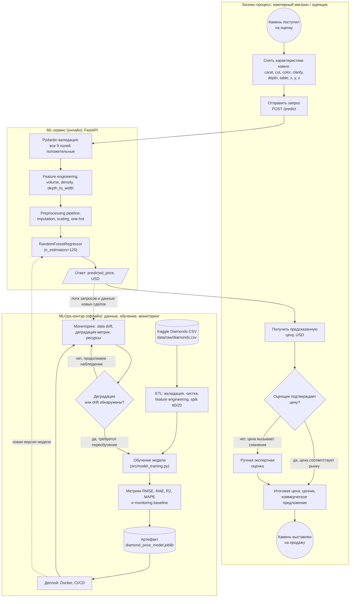

# Модель в бизнес-процессе: предсказание стоимости бриллиантов

Документ описывает, какое место ML-модель предсказания цены бриллианта занимает в бизнес- и техническом процессе проекта **Automation ML Diamonds**. Подробное описание самой модели — в [model_card.md](model_card.md).

Схема выполнена в нотации, близкой к BPMN: окружности — события старта/завершения, прямоугольники — задачи, ромбы — шлюзы (решения), цилиндры — данные/артефакты, пунктирные стрелки — информационные потоки.

## Схема процесса

## Какую задачу в процессе решает модель

Модель выполняет **первичную оценку рыночной стоимости камня**: по 9 измеримым характеристикам бриллианта она за доли секунды выдаёт ожидаемую цену в USD. В процессе это шаг между «камень поступил на оценку» и «итоговая цена для покупателя»: вместо ручного подбора аналогов по прайс-листам оценщик получает стартовую цифру и тратит своё время только на её проверку. Модель не принимает финальное решение — при сомнениях процесс уходит в ручную экспертную оценку (шлюз «Оценщик подтверждает цену?»).

## Почему для этой задачи целесообразно использовать ML

- Зависимость цены от характеристик **нелинейна и зависит от взаимодействий** признаков (вес × чистота × огранка): фиксированный прайс-лист или линейная формула дают заметно бо́льшую ошибку, ансамбль деревьев улавливает эти зависимости (R² ≈ 0.96 на тесте).
- Есть **исторические данные с реальными ценами** (Kaggle Diamonds, десятки тысяч записей) — задачу можно обучить с учителем, разметка не требует дополнительных затрат.
- Задача **массовая и повторяющаяся**: каждый поступающий камень — это та же оценка, поэтому автоматизация окупается, а единая модель даёт единообразие оценок у разных сотрудников.
- Требуется **скорость**: один REST-запрос быстрее консультации со справочником, при этом модель работает 24/7 в контейнере.
- Признаки — объективные измерения камня (караты, размеры, грейды), они уже фиксируются при поступлении товара, поэтому стоимость инференса для бизнеса практически нулевая.

## Какие данные поступают на вход модели

На вход через `POST /predict` поступают 9 характеристик одного камня:

| Признак | Тип | Описание |
|---|---|---|
| `carat` | число | Вес в каратах (например 0.5) |
| `cut` | категория | Огранка: Fair, Good, Very Good, Premium, Ideal |
| `color` | категория | Цвет: D–J (от бесцветного к желтоватому) |
| `clarity` | категория | Чистота: I1, SI2, SI1, VS2, VS1, VVS2, VVS1, IF |
| `depth` | число | Глубина огранки, % |
| `table` | число | Площадка, % |
| `x`, `y`, `z` | числа | Длина, ширина, глубина в мм |

Сервис дополнительно вычисляет три производных признака — `volume = x·y·z`, `density = carat / (volume + 0.001)`, `depth_to_width = depth / (x + 0.001)` — и пропускает все 12 признаков через preprocessing-pipeline (импутация, масштабирование, one-hot кодирование), обученный вместе с моделью.

## Как результат работы модели используется дальше

- **В основном процессе** — `predicted_price` в USD возвращается оценщику: он сверяет её с рынком и либо утверждает итоговую цену (ценник, коммерческое предложение), либо отправляет камень на ручную экспертную оценку. Для покупателя это прозрачное обоснование цены.
- **В MLOps-контуре** — ответы сервиса и данные новых сделок попадают в мониторинг: `detect_data_drift` сравнивает распределения признаков с baseline, `detect_degradation` — текущее качество с метриками обучения (RMSE вырос более чем на 15 % или R² упал более чем на 0.10). При срабатывании порогов модель переобучается на актуальных данных и новая версия разворачивается через CI/CD.

Замечание о текущей реализации: контур мониторинга в проекте работает (baseline сохраняется, drift и деградация детектируются), но решение о переобучении пока принимает разработчик вручную — автоматического триггера переобучения нет.
