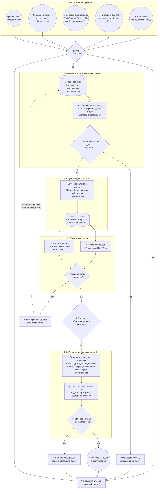

# Процесс автоматического переобучения модели

Документ описывает процесс автоматического переобучения модели предсказания стоимости бриллиантов — от возникновения триггера до развертывания новой версии в эксплуатации. Описание самой модели — в [model_card.md](model_card.md), её место в основном бизнес-процессе — в [Model_BPMN.md](Model_BPMN.md).

Общий принцип: пока новая версия не прошла все проверки, в эксплуатации остаётся текущая модель. Переобучение проходит в отдельном candidate-контуре, и продакшен меняется только после успешного прохождения шлюзов качества и деплоя. Схема в нотации, близкой к BPMN: окружности — события, прямоугольники — задачи, ромбы — шлюзы (решения), цилиндры — данные и артефакты.

## Схема процесса

## Описание этапов

### 1. Триггер запуска переобучения

**Что происходит.** Процесс запускается одним из событий:

- **расписание** — периодический запуск (например, раз в месяц), чтобы модель не отставала от рынка даже без явных сигналов;
- **data drift** — мониторинг зафиксировал, что среднее числового признака сместилось более чем на 25 % относительно baseline-профиля (`detect_data_drift`);
- **деградация качества** — RMSE вырос более чем на 15 % или R² упал более чем на 0.10 относительно метрик обучения (`detect_degradation`);
- **обновление данных** — появилась новая версия датасета (`diamonds.csv`) или накоплена партия данных о реальных сделках;
- **ручной запуск** — решение разработчика (например, после изменения препроцессинга).

**Результат на выходе →** сигнал «пора переобучаться» и запуск этапа подготовки данных. Если триггер не сработал — мониторинг продолжается в фоне.

### 2. Получение и подготовка новых данных

**Что происходит.** Забирается свежая версия данных: обновлённый `diamonds.csv` и/или накопленные записи о реальных сделках. Данные проходят существующий ETL-пайплайн (`src/data_processing.py`): валидация обязательных колонок и типов, чистка (дубликаты, пропуски, физически некорректные значения), feature engineering (`volume`, `density`, `depth_to_width`), разбиение 80/20 с фиксированным `random_state`.

**Результат на выходе →** обучающая и hold-out тестовая выборки (`train.csv`, `test.csv`) в `data/processed/`. Если проверки качества данных не пройдены — алерт разработчику и остановка процесса: текущая модель остаётся в эксплуатации без изменений.

### 3. Обучение новой версии модели

**Что происходит.** Обучается **candidate-модель** — тот же sklearn Pipeline (препроцессинг + `RandomForestRegressor`), с зафиксированным `random_state` для воспроизводимости. Обучение происходит в отдельном контуре (CI-джоба), продакшен-контейнер продолжает обслуживать запросы текущей версией.

**Результат на выходе →** candidate-артефакт `diamond_price_model_vN.joblib` и предсказания на hold-out выборке, которые передаются на проверку качества.

### 4. Проверка качества модели

**Что происходит.** Три уровня проверок:

- **метрики на hold-out** — RMSE, MAE, R², MAPE (`calculate_metrics` в `src/model_training.py`);
- **сравнение с текущей версией** — применяются пороги, уже используемые в мониторинге: новая модель не хуже baseline более чем на 15 % по RMSE и более чем на 0.10 по R² (фактически тот же вызов `detect_degradation`);
- **функциональные проверки** — автотесты pytest (ETL, модель, API, мониторинг) и smoke-запрос к `/predict` на типовом камне.

**Результат на выходе →** вердикт «пороги пройдены / не пройдены» вместе с набором метрик для принятия решения.

### 5. Принятие решения о публикации

**Что происходит.** Шлюз-решение: публиковать новую версию, если все проверки качества пройдены и метрики не хуже установленных порогов относительно текущей модели. Решение фиксируется вместе с метриками, чтобы у версии было обоснование.

**Результат на выходе →** либо команда «зарегистрировать и задеплоить vN», либо отказ. При отказе: prod не меняется, формируется отчёт о причинах (какие метрики не прошли), разработчик получает алерт и итерирует — возвращает процесс на этап данных или настройки модели. Кандидат отбрасывается.

### 6. Регистрация новой версии

**Что происходит.** Принятая версия фиксируется: versioned-артефакт `models/diamond_price_model_vN.joblib`, метрики `metrics_vN.json`, обновление monitoring baseline (`reports/monitoring/baseline.json` — теперь деградацию меряют относительно новой версии) и git-тег версии. Так всегда можно узнать, какая версия модели в эксплуатации, какими метриками она обоснована и вернуться к любой предыдущей.

**Результат на выходе →** зарегистрированная версия vN, готовая к развертыванию.

### 7. Деплой модели

**Что происходит.** CI/CD (.github/workflows/ci-cd.yml): линтеры, автотесты, сборка Docker-образа с новым артефактом внутри, подмена артефакта и рестарт контейнера. После поднятия сервиса — проверка живости: `GET /health` (статус сервиса, модель загружена, метрики инфраструктуры) и контрольный smoke-запрос `POST /predict`.

**Результат на выходе →** новая версия обслуживает запросы; процесс возвращается в режим фонового мониторинга, и его метрики становятся новым baseline.

### Действия при неуспешных проверках

| Точка отказа | Что происходит | Состояние продакшена |
|---|---|---|
| Качество данных (этап 2) | Алерт, инцидент, исправление данных, повторный запуск | Не меняется — работает текущая версия |
| Пороги качества (этап 4) | Отчёт о метриках, алерт, итерация по данным/гиперпараметрам, обучение нового кандидата | Не меняется |
| Health check после деплоя (этап 7) | Автоматический откат на предыдущую версию артефакта, алерт | Возвращается предыдущая рабочая версия |

Ключевое свойство процесса: **любой отказ оставляет систему в работоспособном состоянии** — либо с прежней моделью, либо с откатом к ней; сломанная версия в эксплуатацию не попадает.

## Статус реализации в проекте

Уже реализовано: ETL и чистка данных, обучение pipeline, расчёт метрик, baseline (`baseline.json`), детекция drift и деградации с порогами (`src/monitoring.py`), автотесты, Docker и CI/CD, health check `/health`.

Проектируется (описано выше как целевой процесс): автоматический планировщик-триггер, разделение candidate/prod-артефактов и версионирование (vN), автоматический откат. Сейчас решение о переобучении принимает разработчик вручную — см. замечание в [Model_BPMN.md](Model_BPMN.md).
